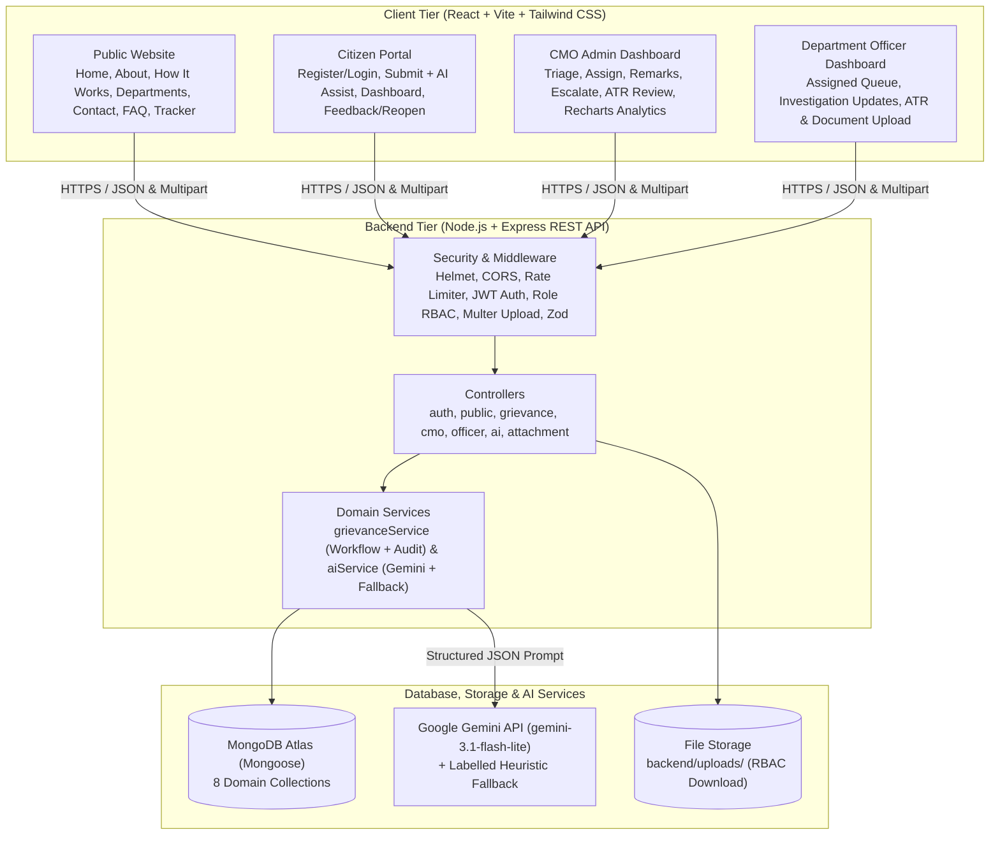

# 02. System Architecture

## 1. High-Level Architecture Diagram

See also the standalone diagram files:
- Vector SVG: [system-architecture.svg](./diagrams/system-architecture.svg)
- Mermaid source: [system-architecture.mmd](./diagrams/system-architecture.mmd)

## 2. Layer Breakdown

### 2.1 Frontend (`frontend/`)
- **Framework:** React 18 bundled with Vite (`frontend/vite.config.js`), styled with Tailwind CSS (`frontend/tailwind.config.js`).
- **Routing & RBAC Guards:** `react-router-dom` routes split into Public pages, Auth pages, Citizen Portal (`/citizen/*`), CMO Dashboard (`/cmo/*`), and Officer Dashboard (`/officer/*`). `ProtectedRoute` enforces role-appropriate views client-side while backend middleware enforces authoritative security.
- **State & Networking:** `AuthContext` manages JWT session persistence in `localStorage` and validates active tokens via `GET /api/auth/me`. `api` (`frontend/src/api/client.js`) attaches `Authorization: Bearer <token>` headers and supports binary blob downloads for protected attachments.
- **Visualizations:** `recharts` renders live district-wise and department-wise bar charts from `/api/cmo/stats`.

### 2.2 Backend (`backend/`)
- **Entry & App Factory:** `backend/src/server.js` connects to MongoDB, triggers idempotent initial demo seeding when `AUTO_SEED_IF_EMPTY=true` and the `departments` collection is empty, and mounts the Express app created by `createApp()` in `backend/src/app.js`.
- **Middleware Stack:**
  - `helmet` for HTTP security headers.
  - `cors` configured via `CORS_ORIGIN`.
  - `express-rate-limit` on `/api/auth/*`, `/api/ai/analyze`, and `/api/contact`.
  - `authenticate` & `authorizeRoles(...)` (`backend/src/middleware/auth.js`) for JWT validation and strict role checks (`citizen`, `cmo_admin`, `department_officer`).
  - `uploadAttachment` (`backend/src/middleware/upload.js`) using `multer` v2 with UUID filenames, 5 MB file limit, and extension + MIME allowlists.
  - `zod` schemas inside controllers + centralized `errorHandler` (`backend/src/middleware/errorHandler.js`).
- **Optional Single-Service Hosting:** When `SERVE_FRONTEND=true` and `frontend/dist/index.html` exists, Express serves the static React build with SPA fallback.

### 2.3 Database & Storage
- **MongoDB Atlas + Mongoose ODM:** 8 collections storing users, departments, grievances, workflow history, assignments, attachment metadata, citizen feedback, and public contact enquiries.
- **Attachments:** Uploaded files are written to `backend/uploads/` with randomized UUID names and served exclusively through `GET /api/attachments/:id/download` after verifying user authorization against the parent grievance.

### 2.4 AI Architecture
- `backend/src/services/aiService.js` coordinates duplicate similarity checking against recent MongoDB grievances and invokes the Google Gemini REST API (`generateContent` with `responseMimeType: application/json`).
- On missing API keys or external API errors, execution gracefully falls back to `analyzeWithFallback`, explicitly flagging `isFallback: true` and `fallbackReason`.
