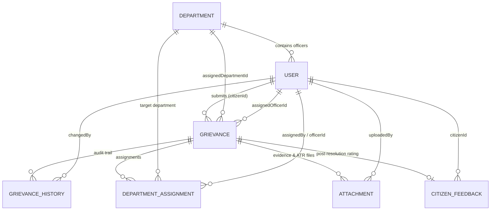

# 03. Database Design

## 1. Entity-Relationship Diagram

See also the standalone diagram files:
- Vector SVG: [database-er.svg](./diagrams/database-er.svg)
- Mermaid source: [database-er.mmd](./diagrams/database-er.mmd)

## 2. Collections & Schemas (Mongoose)

### 2.1 `User` (`backend/src/models/User.js`)
Stores citizens, CMO administrators, and department officers.
- `_id`: ObjectId (PK)
- `name`: String (required, max 120)
- `email`: String (required, unique, lowercase)
- `mobileNumber`: String
- `passwordHash`: String (required, `select: false`, bcrypt hashed)
- `role`: Enum `['citizen', 'cmo_admin', 'department_officer']` (indexed)
- `departmentId`: ObjectId → `Department` (nullable; set for officers)
- `designation`: String
- `district`: String
- `isActive`: Boolean (default `true`)
- `createdAt`, `updatedAt`: Timestamps

### 2.2 `Department` (`backend/src/models/Department.js`)
Stores participating Kerala government departments (8 seeded departments).
- `_id`: ObjectId (PK)
- `name`: String (required, unique)
- `code`: String (required, unique, uppercase, e.g. `PWD`, `HEALTH`, `KSEB`)
- `description`: String (required)
- `headDesignation`: String
- `slaDays`: Number (default `7`)
- `categories`: `[String]`
- `contactEmail`: String
- `isActive`: Boolean (default `true`)

### 2.3 `Grievance` (`backend/src/models/Grievance.js`)
Core complaint record with SLA tracking, escalation state, ATR text, and advisory AI metadata.
- `_id`: ObjectId (PK)
- `referenceId`: String (required, unique, indexed, format `KL-CMO-YYYY-XXXXXX`)
- `citizenId`: ObjectId → `User` (required, indexed)
- `district`: Enum (all 14 Kerala districts, indexed)
- `category`: Enum (10 categories, indexed)
- `subject`: String (required, max 200)
- `description`: String (required, max 5000)
- `priority`: Enum `['Low', 'Medium', 'High']` (indexed)
- `status`: Enum `['Submitted', 'Under Review', 'In Progress', 'Resolved', 'Reopened']` (indexed)
- `workflowStage`: String (granular step label inside the 5 official statuses)
- `assignedDepartmentId`: ObjectId → `Department` (indexed)
- `assignedOfficerId`: ObjectId → `User` (indexed)
- `dueDate`: Date (required; High +3d, Medium +7d, Low +14d)
- `isEscalated`, `escalationReason`, `escalatedAt`, `escalatedBy`
- `actionTakenReport`, `atrSubmitted`, `atrSubmittedAt`, `atrSubmittedBy`
- `resolvedAt`, `reopenedCount`
- `aiAnalysis`: Embedded object (`suggestedDepartmentCode`, `suggestedDepartmentName`, `suggestedCategory`, `recommendedPriority`, `summary`, `reasoning`, `potentialDuplicates[]`, `source`, `model`, `isFallback`, `fallbackReason`, `citizenAccepted`, `cmoReviewed`, `analyzedAt`)

### 2.4 `GrievanceHistory` (`backend/src/models/GrievanceHistory.js`)
Immutable audit log recording every lifecycle transition and remark.
- `grievanceId`: ObjectId → `Grievance` (indexed)
- `previousStatus`, `newStatus` (Enum of 5 statuses)
- `workflowStage`, `actionType` (`SUBMITTED`, `CMO_REVIEW`, `ASSIGNED`, `OFFICER_UPDATE`, `ATR_SUBMITTED`, `REMARK_ADDED`, `ESCALATED`, `RESOLVED`, `REOPENED`, `FEEDBACK_ADDED`)
- `remarks`: String
- `isInternal`: Boolean (when `true`, hidden from citizen dashboard and public tracker)
- `changedBy`: ObjectId → `User`
- `changedByName`, `changedByRole`
- `createdAt`: Timestamp

### 2.5 `DepartmentAssignment` (`backend/src/models/DepartmentAssignment.js`)
Tracks CMO forwarding and reassignment records.
- `grievanceId` → `Grievance`, `departmentId` → `Department`, `officerId` → `User`, `assignedBy` → `User`
- `instructions`, `dueDate`, `status` (`Active` | `Completed` | `Reassigned`), `assignedAt`, `completedAt`

### 2.6 `Attachment` (`backend/src/models/Attachment.js`)
Tracks uploaded citizen evidence and department ATR documents.
- `grievanceId` → `Grievance`, `uploadedBy` → `User`, `uploadedByRole`
- `attachmentType`: `'supporting_evidence'` | `'action_taken_report'`
- `originalName`, `storedName`, `mimeType`, `sizeBytes`, `storagePath`

### 2.7 `CitizenFeedback` (`backend/src/models/CitizenFeedback.js`)
Post-resolution citizen satisfaction ratings.
- `grievanceId` → `Grievance` (unique), `citizenId` → `User`
- `rating`: Number (1–5), `isSatisfied`: Boolean, `comment`: String

### 2.8 `ContactEnquiry` (`backend/src/models/ContactEnquiry.js`)
Public Contact Us enquiries.
- `name`, `email`, `subject`, `message`, `status` (`New` | `Reviewed` | `Responded`)
